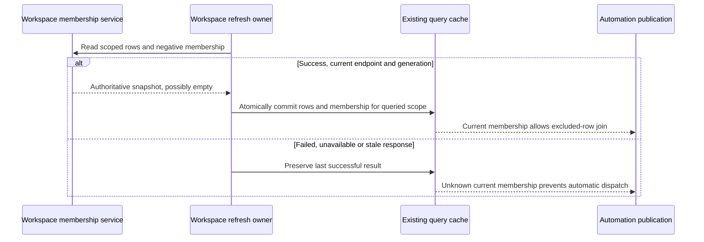

# Runtime trust: negative membership and cleanup activity

This change eliminates two fail-open conversions: a rejected tombstone RPC becoming an empty exclusion set, and absent runtime activity becoming permission to delete an old transcript. It also prevents a partial workspace refresh from replacing unrelated authoritative membership.

The tasks-index service remains the membership authority. The existing bounded task-query cache stores each workspace's successful negative membership together with its row result, membership revision and endpoint service identity. A failed or unavailable negative read rejects the refresh; previous display and exclusions survive, but automatic work requires a successful snapshot for the current revision and endpoint. A successful empty response is authoritative. There is no new durable tombstone store. B-only refreshes cannot change A's membership; remote reconnects require the new service instance to authenticate membership. Existing invalidation/generation checks reject late results. Cache eviction is unknown membership and requires hydration before automation.

The normal running projection may show live running sessions while membership hydrates. It excludes known deletion tombstones, but continues to show truly running pinned/archived sessions. Automatic retry and crash-resume additionally exclude archived and pinned membership under the existing contract, and publish no automatic work from a workspace whose negative membership is unknown. Authoritative exclusions apply to stale committed rows as well as live-only rows.

Storage cleanup retains the existing storage service, category catalog, traversal and deletion guards. `isSessionActive` is tri-state: only explicit false proves inactivity; true, undefined/null, exceptions and a missing provider preserve transcripts. Recent, future and invalid timestamps remain additional preservation guards. The application layer may await an injected runtime provider, while the pure planner consumes the resolved observations. No Main process count, old mtime, or missing session is evidence of inactivity. ZAICODE and ZCode currently share CLI data, so Main's own Host inventory cannot certify inactivity in the entire data root. Production must preserve unknown sessions until a provider with appropriate owner/root coverage is available; do not invent a shadow session registry.

Production runtime authority is the owning CLI session/subagent runtime through the existing Agent service (`listSessionSubagents`/passive session reads). Main's resource telemetry is process attribution, carries no authoritative per-session inactivity proof, and cannot safely substitute for that authority. This mission does not change CLI data ownership or migrate shared roots.

Tests use existing membership promise caching, refresh holds, query-cache invalidation, real retry/crash-resume planners and storage fake ports. Destructive filesystem fixtures operate only in freshly allocated temporary directories. Packaged boot and subscription probes use an isolated profile and keep the installed application's bytes unchanged; lack of genuine model admission remains NOT_VERIFIED.
