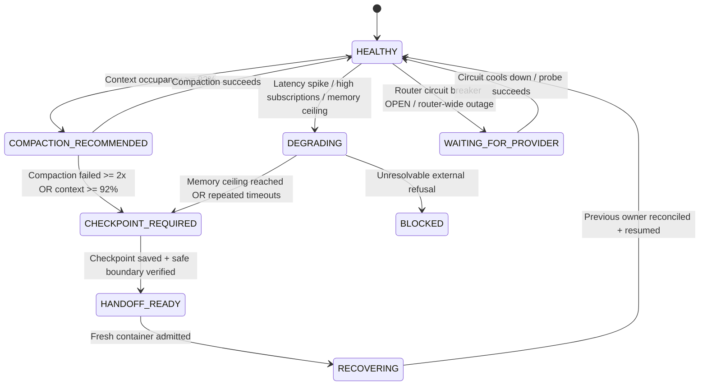

# Long-Running Session Health and Degradation Recovery (T-365 / SRC-270)

Deterministic detection and recovery for gradual session degradation during
autonomous runs lasting 6, 12, or 24+ hours.

## Ownership and Core Invariants

1. **Age Independence**: Session age alone does NOT cause failure or degradation.
   A healthy 12-hour or 24-hour session continues uninterrupted without restarts.
2. **Safe Compaction**: When context pressure is confirmed, safe context compaction
   is invoked, preserving the active objective, approved plan, and pending work.
3. **Continuation Checkpointing**: When compaction is insufficient or fails
   consecutively, a verifiable durable continuation checkpoint is generated.
4. **Execution Boundary Safety**: Session migration occurs ONLY at a safe execution
   boundary (no active tool calls; never terminate active tools without safe cancellation).
5. **No Tool Duplication**: Migration NEVER replays completed tool actions.
6. **Authority Preservation**: Canonical SAIPEN authority (`saipen_home`, `ticket`,
   `STATE.md`, `BOARD.md`, receipt) is strictly preserved across compaction and migration.
7. **Resource Integrity**: Outstanding subscriptions, listeners, and timers are
   tracked and released, eliminating Host and Renderer memory leaks.

## Session Health States

## Durable Continuation Checkpoint Schema

- `schemaVersion`: 1
- `checkpointId`: Globally unique identifier (`cp-<timestamp>-<hash>`)
- `createdAt`: ISO-8601 timestamp
- `originalOperatorObjective`: Verbatim original goal/prompt
- `activeSaipenTask`: Authoritative ticket (e.g. `T-365`)
- `activeSaipenPhase`: Authoritative phase (e.g. `BUILD`)
- `verifiedProgress`: Array of verified items / test proofs
- `unfinishedWork`: Explicit list of unfinished tasks
- `durableDecisions`: Architectural and design decisions
- `filesAndRevisionsTouched`: Touched files with actions (`created`, `modified`, `deleted`)
- `validationEvidence`: Executed commands, exit codes, pass/fail status
- `executionIdentity`: Session ID, owner (`saipen-cli`), seat, authority receipt
- `exactNextAction`: Deterministic next authorized instruction
- `completedToolCallIds`: All executed tool call IDs (must NOT be replayed)
- `tokenSnapshot`: Context token counts and occupancy estimate

## Failure Correlation Engine

Every failed request captures:
- Session ID and session uptime (seconds)
- Request duration (ms) and HTTP status code
- Input and output tokens
- Context occupancy estimate
- Recent compaction state
- Process memory (heap and RSS)
- Router request correlation ID and upstream model/provider
- Exact failure stage (`preflight`, `model_request`, `streaming`, `tool_execution`, `post_processing`)

The correlation engine isolates failures into:
1. `growing_context`: Failures strongly correlate with context occupancy >= 80%
2. `specific_upstream_provider`: Failures isolated to one specific upstream provider
3. `router_resource_pressure`: Multi-provider timeouts indicating router gateway congestion
4. `process_memory_growth`: Heap growth exceeding 1.5GB
5. `timeout_configuration`: Upstream latency exceeding configured threshold
6. `general_network_instability`: Transient transport errors
