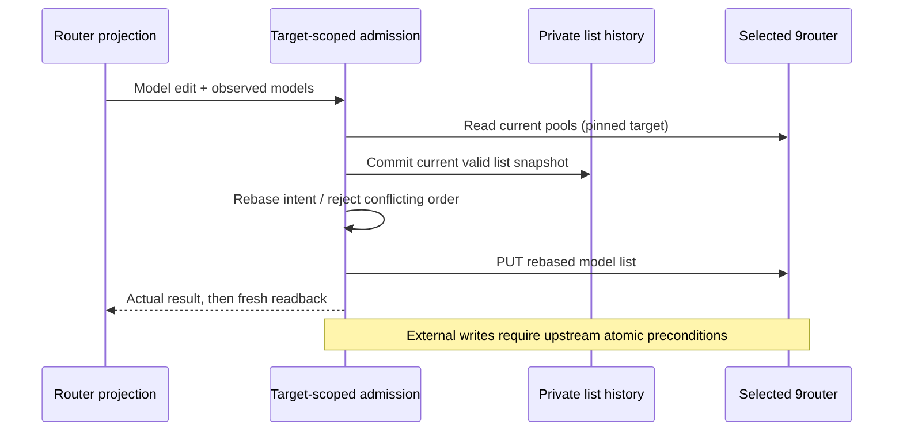

# Router list synchronization and recovery

T-263 / SRC-169 R003, R005, R006. The selected 9router remains the sole owner
of accepted pools, provider connections and settings. Renderer rows are a
projection; recovery files are historical model lists, never another live
configuration. Desktop main owns admission and private recovery IO.

## Model edits

The renderer sends the observed model list with a model edit. Desktop captures
the selected endpoint/data directory before admission and serializes mutations
for that exact target. It reads current pools, saves a durable recovery copy,
then rebases the intended addition, removal or order change onto current rows.
External additions survive; external removals are not resurrected. An add or
remove preserves an external reorder. Incompatible simultaneous reorders
produce a visible conflict and no write. Deleted pools are never recreated by
a stale edit. Maintenance uses the same observed-list contract.

The installed 9router 0.5.91-extra PUT route has no atomic revision/CAS
precondition. Read/rebase/write cannot prove preservation of an external write
between the last read and PUT. This implementation must not claim that full
concurrent-writer requirement is complete; upstream atomic admission and an
actual packaged two-writer acceptance remain required.

## Recovery and presets

Successful valid pool observations and pre-edit lists are saved under the
selected router data directory, privately and atomically. Automatic recovery
keeps the latest 50 distinct nonempty lists; explicitly named presets persist.
Only pool identity, name, kind and ordered model IDs are stored. Credentials,
provider records and settings never enter these files or the renderer.
Content hashes detect corruption. Invalid or partial list responses never
replace a good snapshot. A failed pre-edit backup prevents the edit.

The Pools page lists automatic backups and named presets, can save a named
preset, and explicitly confirms restoration. Restore replaces matching pools'
model lists, recreates missing pools, leaves additional current pools alone,
and preserves current providers, credentials and settings. Current lists are
backed up first. Partial HTTP failures report the completed pool count; they
never claim a transaction or delete successful partial results. History is
scoped to its endpoint and data directory; changing target during admission
cannot redirect an edit or restore.

## Live projection and scope

While the Router settings surface is mounted, periodic reads and focus reads
observe external edits. Only the newest requested refresh may publish rows.
Failures retain the last valid rows; unmount removes timers/listeners.
The user's explicit live-sync request authorizes these reads.

Shared/internal router databases remain independent. These list recovery
changes do not migrate credentials or prove preservation across mode changes.
That original R005 requirement remains open until its complete owner contract
and actual shared/internal acceptance are implemented.

Acceptance uses a recording HTTP router through the production desktop
transport: late external add/remove/reorder, conflict, deletion, two local
writers, target switching, snapshot persistence across owner recreation,
corruption and backup-write refusal, presets, deletion/damage restoration and
partial restore errors. Renderer tests verify newest-refresh publication and
observed-list carriage. Packaged controls must demonstrate save and confirmed
restore against an isolated profile. Required root typecheck/lint/architecture
gates run before reporting any verified local delta. Full T-263 closure still
requires atomic two-writer and shared/internal credential/settings evidence.
