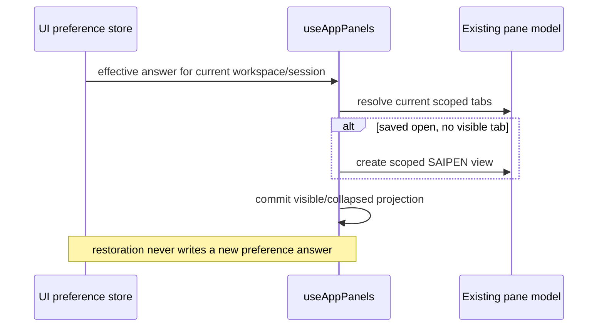

# Restore an explicitly open SAIPEN side pane

SRC-154:R003 requires the saved Everywhere or project/session answer to survive
restart. Native acceptance on the current package found the Boolean persisted,
while the tab itself lived only in a renderer module Map. After restart the
scope resolver saw no tab and forced the pane closed despite the saved open
answer. A remembered answer must produce an actual visible pane.

`useAppPanels` remains the single owner of tab and collapsed state. The existing
UI preference store remains the only writer of the saved visibility policy.
Restoration is a pure projection: when the current scope explicitly requests
open but has no visible tab, create its scoped read-only SAIPEN tab using the
existing factory and ownership stamping. Preserve visible browser/code/task
content when it exists. Do not copy content from another project or session,
change saved policy answers, start work, or create tabs for an explicitly closed
or unremembered empty scope. No workspace means no default pane.

Apply the projection during initial state creation and scope changes, so the
first rendered state and subsequent restoration agree. Ctrl+Alt+B, explicit
close/open, and policy selection retain their existing write path.

Verification: retain all warm workspace/session cases, add full-module reloads
with saved global and per-session choices plus a never-opened workspace, prove
the same oracle fails the preserved pre-fix owner, and rerun native packaged
restart, keyboard, rail, composer, file-edit, and Retry acceptance. Native
project-draft cases must not be reported as persisted real-session coverage.

Cold-start coverage must inspect actual visible scoped tabs, their workspace
and owner, and unchanged saved preference bytes. Cover global open/closed,
distinct sessions in one workspace, an unset empty workspace and no workspace.
Repeat a reload to reject duplicate tabs. Retain an existing visible non-SAIPEN
tab during policy restoration. This supersedes the older vertical-rail spec's
blanket prohibition on creating tabs during restoration: an explicitly saved
open answer requires content, while closed and unremembered scopes do not.
