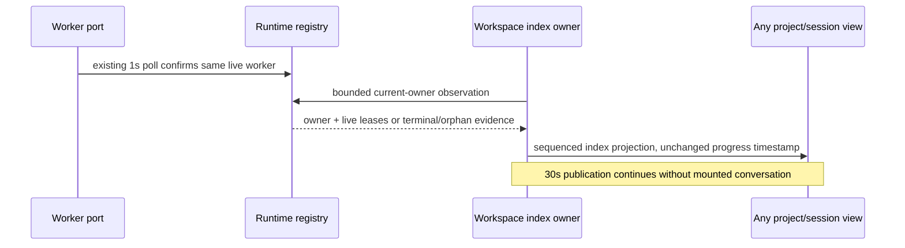

# Runtime-owned execution liveness

Eliminate mounted-view ownership and age-only interpretation of quiet work.
The original SRC-161 liveness requirements and ten behavioral cases apply in
full. A completed queue-lease test alone does not prove session indicators.

## Owner and contract

Each actual AgentRuntime instance owns an ephemeral identity. Its foreground
execution handle and runtime task registry own current work. The existing
background tracker confirms a task after a successful snapshot observation;
unchanged output still confirms life. This updates only bounded in-memory
lease facts, not transcript progress or recorded activity. A terminal task
cannot be revived by a late running snapshot.

The public runtime observation reports the current owner, observation time,
lease deadline, foreground identity, background work identities/status/PID,
last positive confirmation, and explicit orphaned/unconfirmed flags. Old
persisted claims without a current owner are recoverable, never completed.
An untracked resumed task is checked through its existing runtime port; a
tracked task reuses its poll's evidence instead of creating another worker
poll. A proven missing task is reconciled through the existing terminal event
path, fenced against a newer or completed registry entry.

The gateway's execution-liveness index owner encapsulates observations,
single-flight, freshness and disposal. Its bridge adapter reads the existing
session runtime. The tool lifecycle provider retains the existing per-tool
snapshot/wait/cancel dispatch; the tracker continues to own polling and events.
The v4 workspace sessions-index carries this additive contract. One mandatory
30-second gateway heartbeat refreshes only current active projections; it is
independent of renderer mounting, list subscribers and optional resource
telemetry. It never loads historic job/session bodies or starts a new runtime.
Per-session single-flight and owner/publisher/sequence fences discard late
observations. Disposal clears the timer and prevents post-await publication.
The existing foreground admission AbortController proves owned preparation
before the runtime execution handle is established.

## Presentation and compatibility

The shared contract supplies host-clock lease validity. The receiving index
store records local arrival per owner/observation, without renewing repeated
or replayed samples. Remote clock offsets therefore do not decide ownership.
UI activity carries that receipt as transport metadata; it is not a heartbeat.
Workspace group caches must observe the same activity contract. An unchanged
title/status/progress timestamp cannot suppress a renewed lease or an ownership
denial. Reuse the existing complete task-equivalence helper for this cache.
Fresh runtime evidence overrides the old 45-minute/five-hour silence heuristic.
Expired or explicitly unowned work is not counted as working and remains
recoverable. Legacy summaries without this field retain their previous
bounded interpretation. A newly observed canonical denial overrides mounted
view hints; a pre-start idle sample cannot cancel a newer running claim.
Owner loss must not be attributed to a deliberate operator Stop.
An orphaned or unconfirmed sibling cannot hide another positively owned worker
or foreground execution. Resumed workers observed terminal use the existing
completion event once; a late registration or poll cannot revive their lifetime.

Desktop continuous and remote replayable consumers use the same sequenced
index contract. Heartbeats do not change transcript sequence/revision, row
identities, progress timestamps, ordering, model budget or completion result.

## Verification

Use controlled clocks for quiet work beyond six hours, fresh and expired
leases, repeat delivery and owner replacement. Exercise actual registry
terminal races, late poll completion, repeated reconciliation and disposal.
Verify index output while no conversation subscriber exists and ensure only
current active work is inspected. Check receiver clock skew and replay.
Run a packaged local-provider scenario that starts a real quiet background
worker, switches projects, observes renewed liveness without progress, waits
for completion and confirms identical state before/after reopening. Exercise
graceful/abrupt host loss and fast restart in the private profile. Preserve
original/current subjects and use one unchanged behavioral oracle. Existing
source, CLI, package and prior interaction gates remain required.
