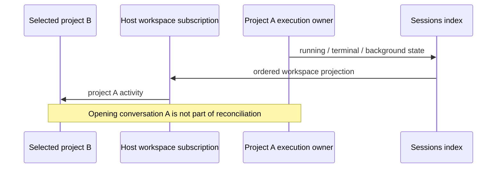

# SRC-161 reliability acceptance

The complete original request remains the outcome contract: nine requirements,
seventeen acceptance conditions and all sixteen original source audit findings.
The old source-only verification is insufficient for packaged interaction and
geometry. Preserve its record and replace its acceptance with current evidence.

## Runtime truth

The CLI execution owner and the service job repository own their respective
work. Workspace sessions-index subscriptions must continue while another
project is selected. Conversation mounting only changes presentation. A normal
terminal event, runtime disappearance and host disposal must withdraw running
claims without navigation. Lease heartbeat and periodic reconciliation must
preserve live long-running work and recover dead persisted owners. Repeated
reconciliation and late terminal events cannot revive a completed attempt.

Packaged acceptance uses a private profile, private project roots and a
loopback-only deterministic provider. Actual native input submits the prompt;
the fixture controls response timing and observes the actual service snapshot
and DOM before and after switching projects. It never contacts a paid model or
rewrites application snapshots. Abrupt and graceful lifecycle cases are checked
against the actual owner, with durable service tests covering lease timing and
idempotency.

## Interaction and geometry

Retry display, tooltip and permission read the existing effective projection.
Legacy alternate right-click preferences cannot orphan settings. Preserve the
current direct settings behavior and trace any changed original acceptance
branch to its later source/implementation rather than claiming an unexecuted
app-menu sequence passed. Attempts, stopped errors, stop-all and quota walls
must survive an actual renderer reload.

The native stop-this-error reload case contradicted the earlier storage-only
proof: the error key survived but the mounted retry predicate ignored it.
The existing persisted stopped-error set is the single owner of suppression.
The open pane must consult it when arming and immediately before an automatic
dispatch. Background and error-queue owners must honor a stopped failure for
that session too. A genuinely new accepted running attempt or a clean finish
retires that session's old error suppression; merely mounting, reading or
reloading a failed session cannot do so. Manual Retry now remains an explicit
one-attempt action. No separate stop store or preference is introduced.

An automatic retry must address the newest failed user request. A retryable
answer from a previous user input cannot take priority over a newer editable
real-user row. Use ordered canonical row/entity identities and preserve the
runtime's action admission; identical text is never an identity signal.

The error-paused queue owns its distinct resume counter in the same existing
durable retry safety record. Spend before dispatch. Restore across renderer
reload without clearing on an absent snapshot; only authoritative drained
queue facts retire that budget. A cap of two cannot produce a third resume
merely because the renderer restarted. Old records without a queue counter
read as an empty queue budget and no released preference snapshot gains it.

Measure actual anchored cards, metrics rows, composer attachment controls and
the stable user/assistant row navigation lane in a current Windows package.
Include narrow/normal widths, open/collapsed sidebars, account counts, rapid
project changes and real cleanup. Cleanup touches only private completed
sessions; running/waiting/MAIN boundaries and unrelated confirmations remain.

## Responsiveness

Revalidate every original audit finding against current files and tests.
Measure the pixel-snap hot path if its broad mutation scans or idle timer
remain. Its existing installer owns discovery, observation, geometry batching
and restoration; no second snapping implementation or component state store.
Unrelated DOM churn must perform no snap-target layout reads or document-wide
target scans after initial discovery. Resize, relevant mount/unmount, target
movement, scroll and explicit markers must still snap to device pixels.
Authored stylesheet insets and external inline position updates remain the
base of a correction. Removing a target or uninstalling the owner restores
its original inline styles; a delayed font callback cannot restart a disposed
installer.

Save original modified inputs before repairs. Use one unchanged behavioral
oracle against the preserved original and corrected source/package. Run the
repository typecheck, lint, architecture and complete test entry, then build
and inspect the current Windows package. A partial check proves only its own
scope. Publication remains governed by existing release authority.
