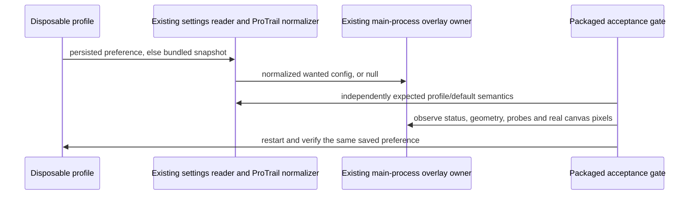

# T-325: preference-aware packaged acceptance and safe release snapshots

This change eliminates two release defects: rejecting a healthy saved ProTrail
Off preference as a missing overlay, and exporting historical continuation
executions as factory settings. Existing T-321/T-322/T-323/T-324 fixes remain.

The existing settings reader owns profile-over-bundled precedence. The existing
ProTrail normalizer owns malformed-input and model defaults. The boot checker
uses these owners and requires an explicit expected configuration; it never
derives success from an absent overlay. Off requires zero overlays and an idle
global input reader. On/everywhere requires one healthy configured overlay per
display, matching geometry, and nonzero synthetic-sweep pixels on every overlay.
No-display is an explicit unavailable drawing result, never pixel proof.

Two disposable profiles persist explicit Off and explicit On/everywhere before
the accepted startup. Each then starts the real packaged application twice.
The renderer's visible switch, saved value, global status, overlay health and
pixel results must agree. The accepted On startup precedes any toggle. Rapid
switches additionally converge without orphan overlays. Existing shell,
Settings, customization and workflow checks remain required.

`captureZaicodeSettingsSnapshot` remains the only export projector. Scheduler
`continuation` is durable policy; `continuationRuns` is runtime history and is
removed recursively from autostart and nested presets. Per-session overrides
and historical auto-continue maps cannot become release defaults. Remaining
session identity keys or scalar values reject the affected family, including
non-JSON scalar settings. No private identifier is logged. Accepted unrelated
preferences retain their original bytes where no volatile field is removed.
Regenerate the bundled document only by calling this capture/export function
against an isolated copy of the previous bundled preferences. Actual operator
storage and runtime history are never written.

Regression controls use synthetic identifiers and the unchanged original
subjects. A fresh isolated Windows package must pass the real gate and identify
the authorized source before GUI/Queue acceptance. Core conformance/publication
blockers remain separate; no commit, push, install or production replacement.

Actual packaged Usage acceptance exposed a separate layout-state defect: a
pointer resize changed the name column from 34% to 39%, but switching Full page
and Sidebar remounted the panel and reset it to 34%. The existing Usage store
owns the accepted column share together with mode/scope. Both hosts read that
one value; pointer edits use the existing bounded width calculation. Switching
mode, scope or closing/reopening must preserve it within the application run.
Non-finite updates preserve the last value; valid shares remain within 12–70%.
This transient layout correction writes no saved operator preferences and
keeps existing formatting, metric readers, column bounds and single-host law.
