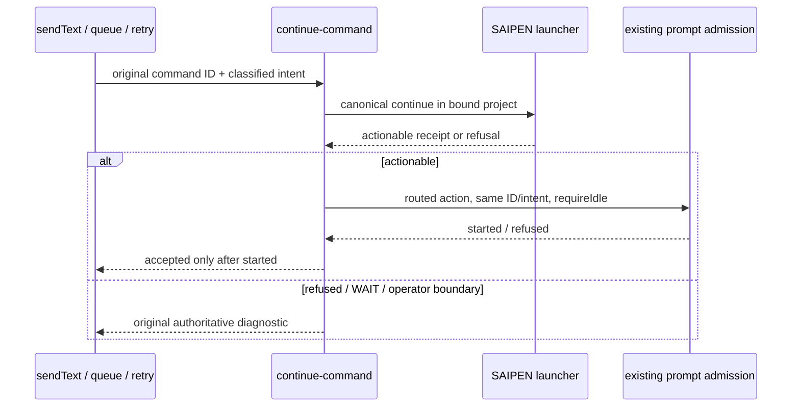

# T-327: execute accepted SAIPEN continuation

This removes acknowledged continuation commands that never start execution.
Previously, a project-owned `cc` called `saipen continue --json`, accepted its
actionable answer, and returned without submitting work to the session. Typing
`saipen continue` bypassed that early return and actually started an agent turn.

The existing continue-command admission remains the single command owner. It
retains exact-token recognition, current goal ownership, original classified
provenance, project isolation, plan/busy protections, and canonical launcher
refusals. The launcher only routes; its success is not execution evidence.

After an actionable project receipt, admission submits the routed work through
the existing `startPromptTurn` / Core `sendInput` path in the SAME session, with
the original input ID and intent. The prompt carries the launcher's actual
action and optional load path, and requires reading current project memory and
executing the action. It does not submit an unexpanded `cc`, fabricate a new
goal, alter a paused goal, or create a second scheduler or execution lock.

Core owns active-turn exclusion and completion. A race, unavailable model,
restore warning, or failed admission is an explicit failure; the recognized
command cannot silently report success. Queue promotion removes its original
item only after execution admission. Duplicate transport IDs retain CommandInbox
deduplication. Automatic continuations cannot acquire operator provenance or
switch from the goal domain into the project domain.

Regression acceptance uses the real command helper and normal prompt admission
with synthetic application ports: accepted routing must reach `sendInput` once,
carry the fresh action/load path, and preserve provenance/session identity.
Refusals, WAIT, busy/plan races, model failure, queue promotion, and independent
session/goal controls remain exercised. Prove the same oracle red before the
fix and green after it. Packaged or live-model evidence is reported separately.
