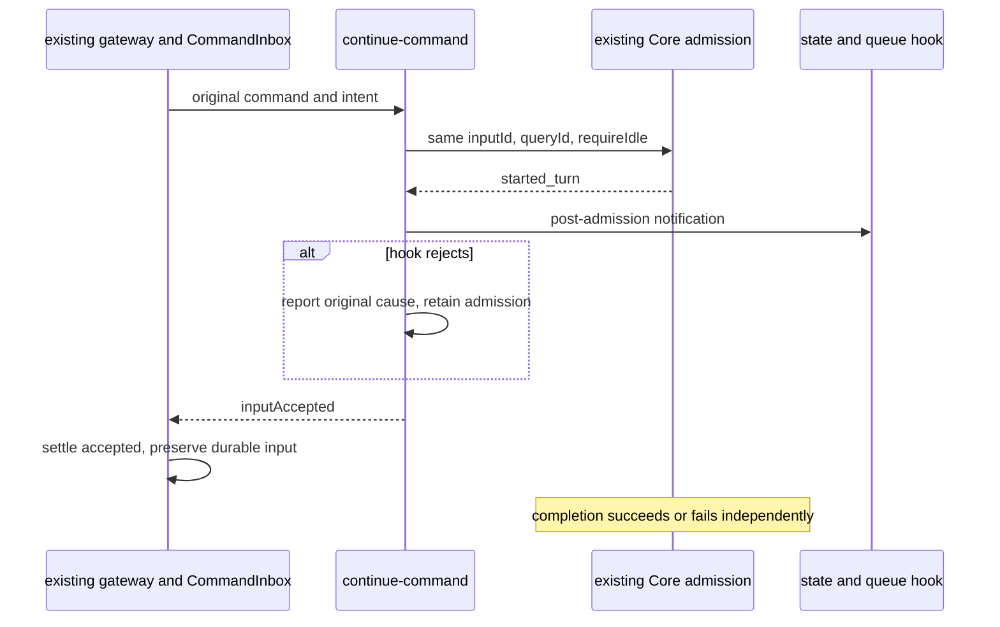

# T-332: keep continuation admission truthful after a hook failure

The native gateway currently cancels a durable input and returns a failed
command when the post-admission state/queue hook rejects, even though Core has
already returned started_turn. The disposable unchanged gateway oracle proves
one dispatch, a failed ACK and an erroneous durable-input cancellation.
An identical command-ID replay remains one dispatch; this is an admission-truth
defect rather than a proved duplicate-dispatch defect.

Core remains the sole turn and completion owner. CommandInbox remains the sole
command replay owner. The existing continue-command path must return the original
inputAccepted result once Core accepted the turn. A later state/queue hook failure
is a separately logged post-admission failure with the original cause, input ID
and session ID. It does not cancel the admitted input, release Core's reservation,
retry a turn, or claim that execution completed successfully.

Before Core acceptance, model/restore/launcher/Core failures remain failed
commands and their original causes remain visible. After acceptance, background
completion still distinguishes prompt_completed from prompt_failed and reports
execution errors through the existing completion path. Even a failing diagnostic
observer must not turn an already accepted input into an unexecuted request.

The error class, busy predicate and canonical refusal formatting move unchanged to a small
diagnostics module so the touched command module respects the 400-line default.
Its existing public error export remains compatible. No new state, execution
lease, scheduler, provider behavior, environment variable or protocol semantics
is introduced.

Acceptance uses the native ConversationV4Gateway, real CommandInbox and command
helper with explicitly controlled application admission ports. It covers
post-start hook failure, same-ID replay, pre-admission model failure, subsequent
execution failure, successful completion, and a failing diagnostic observer.
The same verifier must fail before the correction and pass afterward. Retain
T-327's existing six-case oracle and other continuation/domain controls unchanged.
Packaged execution and provider recovery are distinct evidence and are never
claimed from these controlled port tests.

