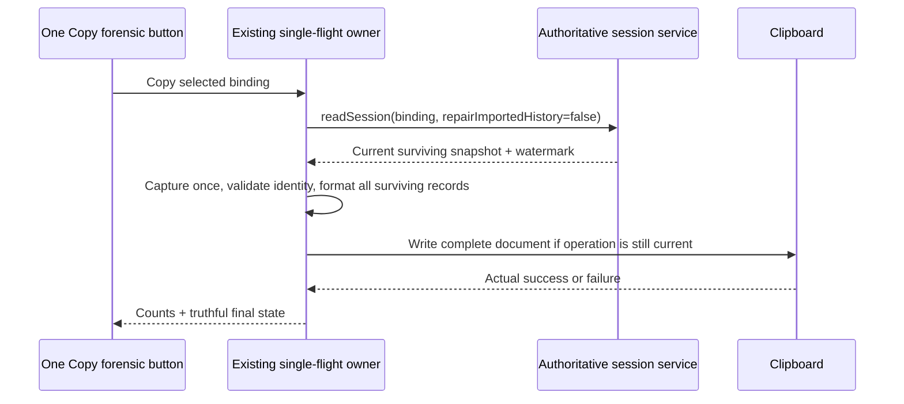

# One authoritative selected-session forensic copy (T-333 / SRC-242)

## Defect class and behavior

Two copy scopes made an ordinary copy omit earlier selected-session evidence and
apply a character budget. The transcript control now has one **Copy forensic**
button. It exports every surviving recorded message/part of the selected session,
in source order, through the authoritative snapshot watermark. There is no scope
dropdown, compact boundary, recent-window fallback or transcript character cap.

## Owners and public contracts

`IZCodeSessionService.readSession` remains the only snapshot owner. The existing
copy function owns capture/identity checks/formatting/clipboard delivery; its hook
owns one in-flight operation and stale-session cancellation. No accepted queue,
history cache or alternate read path is added.

Forensic reads set `repairImportedHistory: false` on the existing service port.
Ordinary reads retain their current default; this explicit policy prevents empty
imported history from being re-created from another source during export. The
authoritative returned snapshot is cloned once immediately on resolution, before
copy-time context IO can let a running source advance beyond the captured watermark.
This is one linear capture, not repeated JSON serialization.

The exact sessionId/workspacePath/workspaceIdentity/remoteSessionId binding is
forwarded. Returned session/workspace and every message/part identity are checked.
Host-provided runtime/branch/loss fields remain in the forensic metadata. Missing
or deleted selected sessions and read failures fail explicitly; no fallback,
workspace index scan, other-session/child transcript fetch or backup recovery.
Legacy snapshots without extra identity fields remain explicitly unverified in
those fields rather than gaining fabricated identity.

## Evidence and delivery

The existing full forensic formatter retains stored human/runtime provenance,
instructions, reasoning, tool input/output/errors, timestamps, IDs and source
limitations. Binary attachments stay bounded references; inline data URLs are
not embedded or fetched. Its attachment helper moves out of the obsolete segment
module and keeps the same reference behavior. Copy-time protocol documents are
separate contextual observations, never transcript messages; archives and project
history are not enumerated. The existing per-context-document read refusal stays
explicit and never truncates the session transcript.

The button preserves accessible keyboard behavior, disabled/loading state and
success/error acknowledgment. It shows **Reading session...**, **Copied forensic**
or **Copy failed**, with actual message/character counts in its detail/tooltip.
Only a successful actual clipboard write produces success. Unmount, target or
service/platform change cancels a stale operation; rapid clicks share the existing
single-flight owner. Desktop and remote/mobile reads use the same public service
and identity contract; no delivery-kind override changes their transport semantics.
Loss of selected-snapshot readiness also cancels a pending operation when the
session ID is unchanged; controls return to idle so a later valid snapshot can be
copied through a fresh read.

## Validation

Freeze a new independent regression before implementation and execute it against
the preserved preimage and final subjects. Cover 2011 messages/6477 parts, first
and last records, complete large output/errors, hidden runtime provenance,
foreign/deleted/archived/child negative controls, exact remote target, snapshot
advancement during context IO, malformed identities, empty/one-message sessions,
read/clipboard failure, stale switch and one accessible action. Rewrite obsolete
compact tests to protect whole-session retention; retain existing forensic tests.
Run root typecheck/lint/architecture/tests with pinned pnpm. Measure actual output
size, latency, memory and read counts in a disposable acceptance profile. A real
packaged limitation is recorded explicitly; current source is never represented
as installed without package parity. Preserve all operator sessions/settings,
running binaries, original ZCode and SAIPEN protocol.
