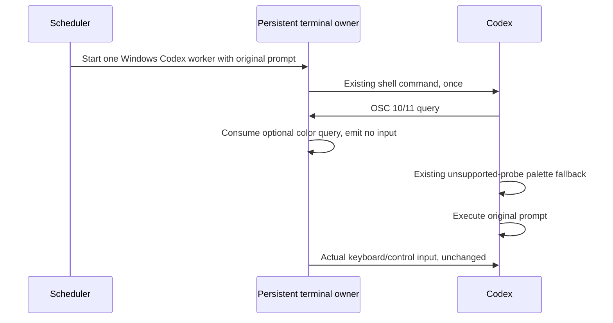

# Windows Codex startup color replies (T-334 / SRC-243)

## Defect and product rule

A scheduled Windows Codex worker receives its prompt as one startup argument.
Codex 0.162.1 probes the terminal's default foreground/background with OSC 10/11.
A response delivered after its bounded startup probe becomes ordinary input:
Escape interrupts the initial turn and the remaining `rgb:...` reaches the composer.
The same incident is reproduced through the actual Windows worker broker with an
isolated Codex home and a loopback synthetic Responses provider. Immediate replies
and unsupported queries complete; replies delayed by 800 ms interrupt the turn.

Windows Codex worker terminals therefore treat these optional default-color
queries as unsupported. Xterm consumes only query-only OSC 10/11 payloads before
its built-in handlers generate replies. Codex uses its existing palette fallback.
The visible app terminal colors remain owned by the existing theme. This loses
exact terminal-background discovery inside Codex; it avoids unsolicited input.

## Ownership and boundaries

- `ZaicodeWorkerTerminal` selects the policy for a real Codex worker on Windows.
- The existing persistent terminal registry owns parser handlers for exactly the
  xterm/PTY lifetime, including detach and remount; release disposes the handlers.
- All user input, including Escape and pasted text, uses its existing input path.
- Color setters, title/hyperlink/clipboard sequences, cursor replies and other
  terminal controls retain their existing handlers. Query-only chained payloads
  are consumed; mixed setter/query payloads retain xterm's semantics.
- Ordinary terminals, shell/fix workers, other vendors and other operating
  systems retain normal dynamic color queries.
- Scheduler admission, run identity, quota occurrence consumption, prompt content,
  Core execution, retries, broker handoff and native PTY ownership are unchanged.
- No persisted setting, migration, CLI config write, delay, or retry is added.
- This local worker path does not change desktop/mobile conversation delivery.

## Acceptance

1. The actual worker component enables the policy only for Windows Codex workers.
2. The actual terminal component installs handlers before output and keeps them
   for detached live terminals; split and repeated query-only color probes produce
   zero native input even when rendered late.
3. Color setters and unrelated OSC sequences retain fallback handling. Keyboard
   Escape, ordinary input and automation commands retain exact bytes.
4. Disposal unregisters handlers; exited/stale native input remains fenced.
5. The same frozen regression fails on both preserved pre-fix source files and
   passes on the corrected source. Existing worker/terminal regressions pass.
6. Real Codex 0.162.1 through the existing native broker reproduces the delayed
   reply failure, while the implemented query policy completes the same prompt
   without leaked color text or interruption, using only a disposable provider.
7. Root typecheck, lint, architecture and relevant/full repository tests pass.
   Production settings, credentials, running workers and executables are preserved.

Upstream reference: [Codex terminal startup probes](https://github.com/openai/codex/blob/main/codex-rs/tui/src/terminal_probe.rs).
Local executable evidence determines this fix; upstream main is explanatory.
