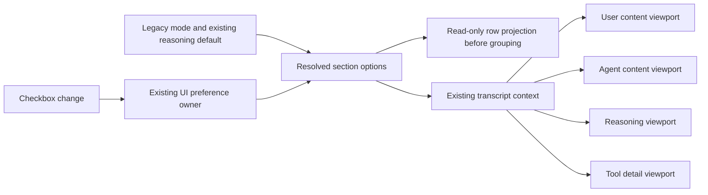

# Independent transcript sections and scroll controls

SRC-245 / T-336 removes mutually exclusive transcript presets and the coupling between every section's inner scrollbar.

## Ownership and compatibility

- Keep `zaicodeUiPrefs.transcriptView` as the single persisted renderer preference. Extend its closed representation with a `kind: sections` value containing User, Agent, Thoughts and Tools visibility/scroll flags plus the existing detail-expansion choice.
- Existing six string values remain readable and preserve their projection semantics. Derive matching checkbox settings without rewriting stored preferences on mount. In Compact, the initial Thoughts flag reflects the existing supplied reasoning preference. An explicit control change writes the new sections value through the existing update action; unrelated preferences remain intact.
- Source transcript rows, IDs, ordering, accepted input, runtime state and forensic export are never edited by filtering. Project before tool/work grouping. Retain turn boundaries and essential failure signals; an all-hidden selection stays recoverable through the controls.
- `TranscriptViewContext` distributes the resolved presentation. Existing User, Agent, Reasoning and Tool viewport components read their own policy; there is no second transcript, scroll-policy store or service.

## Controls and behavior

- Replace preset buttons/native select with four independent visibility checkboxes. Each section also has its own labelled Scroll checkbox. Keep detail expansion as an independent checkbox, preserving the useful Compact/Full behavior.
- Scroll means a bounded inner content area; Off shows the complete loaded section in the main transcript. It does not change the main timeline's follow/reading state. Hiding a section retains its scroll setting for when it is shown again.
- Wide rows show the checkboxes directly. Measure their actual intrinsic width against available control space, including fonts and translated labels. When they do not fit, use the same options and preference callbacks in an accessible popover. No clipped controls, preset dropdown or different mobile semantics.
- Keep keyboard reach, explicit checked/disabled states, viewport collision handling, stable copy/error states, earlier-history controls and navigation. A menu stays open for multiple choices until dismissed; responsive resizing must not erase an active selection.
- Use existing Checkbox, Popover, typography and Golden theme tokens. Localize the visible labels through the existing catalog/intl owner, with readable fallback labels for untranslated locales.

## Acceptance

1. Any mixture of User/Agent/Thoughts/Tools can be displayed, including Thoughts plus Tools without narrative, while source rows and ordering remain unchanged.
2. Four Scroll flags act independently on actual long content. Toggle Off removes the matching inner height cap; toggling another section does not change its peers or the main following flag.
3. Settings survive normal preference round trip, reopening and restart; each legacy mode still resolves safely and unrelated settings are preserved.
4. Wide controls are actual checkboxes. Narrow and larger-font layouts use the same functional options in a collision-safe menu without horizontal overflow. Keyboard activation and focus return work.
5. Full-session forensic copy remains one unfiltered authoritative read even when display sections are hidden; its idle/reading/copied/error behavior is preserved.
6. Native unchanged-oracle preimage/final checks, real-browser interaction, typecheck, lint, architecture and the full repository tests pass. Verify the combined app package with completed T-335 and queued AUTO-scope work before final delivery.
