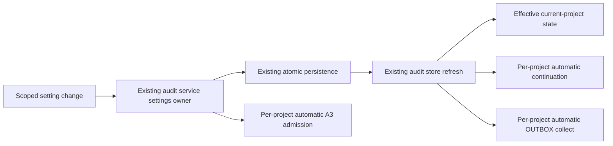

# Sidebar AUTO scope

SRC-246 / T-337 corrects the sidebar AUTO settings' missing distinction between a global default and the current project.

## Owner and compatibility

`IZaicodeAuditService` smart settings remain the durable owner of AUTO mode, automatic A3 admission and the per-project cycle limit. Add identity-keyed partial project overrides beside the existing global fields. Old files with no overrides preserve their global behavior. The existing renderer audit store mirrors service results; it does not persist another policy. Shared pure normalization and projection keep renderer continuation, automatic OUTBOX collect and service audit admission consistent.

Each project inherits a global field until explicitly overridden. Changing a global default preserves every project override; changing or clearing one project preserves all peers. Project identity takes precedence over the local filesystem path. No current project means the project editor is disabled and the global editor remains available. Removing an override restores inheritance without cancelling accepted work or changing runtime/session data.

## Controls

The existing right-click panel offers `Global` and `Current project`. It states which target is being edited and shows the current project's effective state and inheritance. AUTO, automatic A3 and the cycle limit all write to the selected target. `Use global settings` clears only the current project's overrides. The sidebar button displays the current project's effective AUTO state and its source; left-click toggles that effective source. With no current project it toggles the global default, preserving existing fleet behavior. The audit centre uses the same editor.

Changing the editor target alone changes no policy. Pending service writes disable conflicting controls and suspend new renderer AUTO dispatch until the service acknowledges or reports an error. A failed write cannot claim saved state. Explicit session continuation, retry preferences, manual Continue All and manual audits keep their existing independent authority.

## Event order

Every automatic continuation step and automatic A3 admission rechecks its project's current policy immediately before a new side effect. Turning one project off cannot block another enabled project or allow a stale queued step from the disabled project. Existing run identity, wave limits, disabled-project guards, running-work guards and exact-once admission remain in force. Project-only edits retain the shared run identity and do not reset another project's cycle allowance.

## Acceptance

1. The real sidebar context panel exposes both scope choices, applies AUTO/A3/count changes to exactly that target, displays inheritance and supports returning to global defaults.
2. A global ON default with one project OFF leaves peers ON; a global OFF default with one project ON leaves peers OFF. Changing defaults preserves explicit overrides and project identity isolation.
3. The existing service persists scoped settings across reopen, keeps old profiles compatible, rejects invalid fields, and preserves unrelated policy and run identity.
4. Actual service admission starts only enabled projects, retains automatic-audit and wave opt-outs, and rechecks a project disabled during asynchronous queue inspection. Renderer continuation and OUTBOX use the same pure policy and retain explicit/manual safety rules.
5. One unchanged native oracle rejects the original global-only subject and passes the correction. Real-browser scope, persistence, keyboard and narrow-layout checks, current typecheck/lint/architecture and the root test command pass. The final combined package is verified with T-335/T-336 and T-338 before final delivery.
