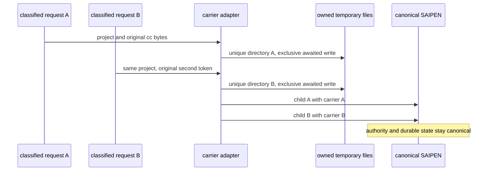

# T-342: immutable continuation request carriers

This correction eliminates concurrent operator-carrier overwrite at ZAICODE's SAIPEN launcher boundary. Two sessions for one project currently share operator-task.txt, so a later submitted command can replace the earlier child's input before that child reads it. SOURCE REQUEST-PROVENANCE-01 still owns authority; this boundary only transports already-classified input.

The existing continuation launcher remains the only process and canonical-answer owner. Its carrier I/O moves to one small internal adapter so the touched owner respects the 400-line default. The adapter snapshots the child environment, preserves any inherited declared carrier, and declares nothing for an absent operator submission. Existing outer-whitespace normalization remains unchanged.

For a real submitted token, create the existing project-scoped directory and one atomically unique request directory using Node's standard asynchronous filesystem APIs. Write the individual operator-task.txt with exclusive creation and await completion before spawning SAIPEN. Never overwrite a peer request. Retain files after the child returns because a canonical refused-ingress resume command can still reference that exact path.

A carrier I/O failure keeps the existing lower-authority environment and does not invent a witness. No global process environment, source receipt, goal counter, valve, execution lease, scheduler or provider adapter is changed. No database or configuration migration and no new environment variable are introduced.

Core still owns requireIdle admission and completion. CommandInbox still owns command replay. A canonical state change before model refusal is not rolled back: an actual disposable-kernel receipt proves normal-to-converge intent mutation, retained task/phase/owner, zero failed-admission dispatch and one later admission without another claim or mutation.

The frozen native two-child barrier must fail on the original subject and pass on the correction: different submitted tokens retain their own files/bytes; inherited external carriers stay unchanged. Existing continuation, provenance, refusal, replay and post-admission-hook suites remain unchanged. Use actual installed compiler/runtime versions, then mandatory source gates and a new isolated current-source package. Controlled transport stubs are not live operator grants or packaged execution proof. Native runtime measurements in this shift are Windows; portable Node APIs and a POSIX fixture path are provided without claiming a macOS/Linux execution that was not run.

