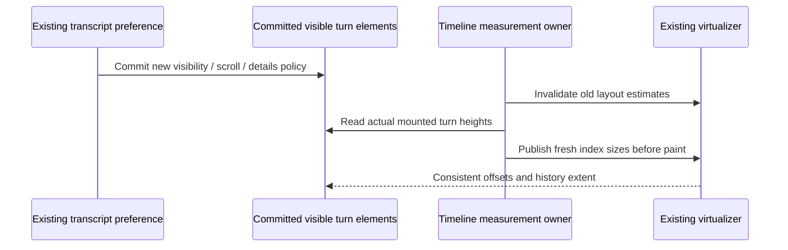

# Transcript filter measurement integrity

T-345 / SRC-254. Operator evidence:
`V:/___VAC/_PIC/_PRNTSCREEN/2026-10-15_183402.png`, preserved under
`.saipen/evidence/T-345/request.png`. Switching transcript filters can make
long history rows overlap and leave the composer inside overflowing text.
SRC-255 / T-346 additionally requests a fresh usable package after the fix.

The timeline owns measured turn geometry and reading/follow state. Filtering
is a read-only presentation change; it must not modify accepted rows, runtime
state, draft contents, session identity or the ordering of visible content.

A transcript policy change invalidates stale heights for offscreen rows.
It must also synchronously repopulate current mounted rows' real heights
before paint. Clearing the virtualizer's size map alone is insufficient:
an unchanged mounted row retains its element/ref and ResizeObserver need not
emit another size observation. No timer, forced timeline remount, permanent
virtualization disable or fixed row-height estimate may stand in for actual
measurement. Measurements use the existing callback/cache and selected
virtualizer; they introduce no second accepted state owner.

Acceptance uses the actual ConversationTimeline/ConversationTurnGroup in a
real browser with long Markdown tables and multiple completed turns. Toggle
a section absent from those turns (no DOM size change), mixed visibility,
section scroll flags and expansion repeatedly. Adjacent mounted turns must
not overlap, total history extent must include its last mounted turn, and the
composer must remain in its intended dock. Existing row nodes, draft text
and user reading/follow behavior survive. Cover desktop/narrow widths,
scrolling history and actual post-fix packaged controls. Run unchanged
original/fixed browser regression, focused existing transcript/scroll tests,
typecheck, lint, architecture, repository suite, then rebuild and verify the
new package before replacing the normal staged build.
