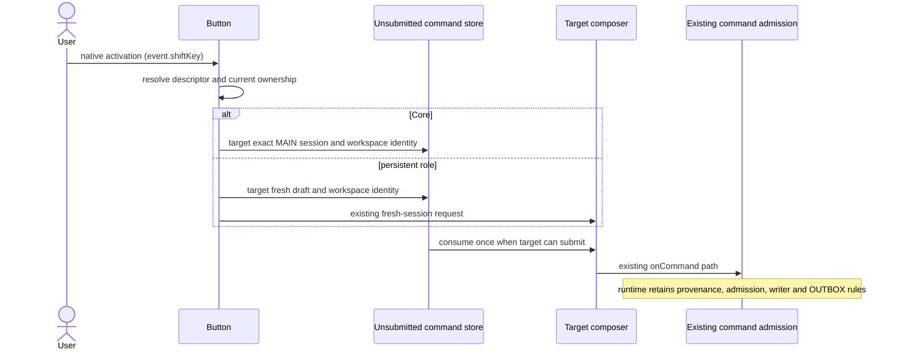

# Composer Core commands and persistent roles

SRC-257 defines seven stable buttons. Ordinary activation sends WIKI `qq`,
TRANSL `saipen translate`, TEST `tt`, HUNT `hh`, AUDIT `aa`, CLEAN
`saipen clean`, and CREW `sc`. Shift activation selects `saiwiki`,
`saitranslate`, `saitest`, or `saihunt` respectively for the first four.
AUDIT, CLEAN, and CREW have no alternate persistent role. The installation's
REGISTRY.json owns Core aliases; its installed role skills own persistent
commands and their OUTBOX admission. UI dispatch does not bypass either.

The typed descriptor owns command, action kind, execution owner, role (only
for supported persistent actions), and permission to run beside MAIN. Core
actions always belong to MAIN and serialize there. The four supported helpers
may run beside MAIN: all four installed charters restrict project access to
read-only and confine writes to their own role namespace and OUTBOX.

When no MAIN exists, Core establishes an ordinary current session (or its new
draft) as MAIN. From an existing persistent helper it opens a separate MAIN
draft, retaining that helper's identity and OUTBOX. A side session sends Core
work to the existing MAIN, retaining the
unsubmitted request while MAIN is busy. It never creates another Core writer.
Persistent actions open a distinct helper and never claim MAIN. A pending
helper launch is consumed only by a draft; a pending Core launch names its
MAIN session. Workspace identity separates equal paths on different hosts.
Queued entries are unsubmitted intents, not a second accepted runtime queue.
Deferred mode intents carry the selected typed descriptor as well as the
command. The consumer uses that action kind and ownership; it does not infer
a new mode's execution owner from command spelling.
Changing MAIN does not retarget an old command to another writer.

Both full and compact views use the same descriptor and native button click
event. Enter, Space, Shift+Enter, and Shift+Space each dispatch once. Shift
preview is cosmetic, resets on key release/window blur, keeps labels and
button order stable, and cannot override the event's actual modifier.
Both variants and their ownership appear in each tooltip. Availability and
parallel emphasis are derived from the selected action. Event propagation
cannot turn one activation into a second command.

Only actual persistent commands infer a durable helper role. Previously
stored WIKI/TRANSL/TEST/HUNT/AUDIT/CLEAN/CREW records retain their storage key
and identity; new Core commands and command-like titles acquire no role.
Arming a helper role is provisional until its composer accepts the command.
A synchronous refusal (`false`) or thrown submission error disarms that
attempt's role, leaving saved session identities and other armed roles intact.
Otherwise a later ordinary Core command could claim the rejected helper's
stale role when its new MAIN session receives an id.
Core mode ownership is provisional as well: a refused or throwing submission
undoes only its own new MAIN binding/reservation. Existing MAIN owners and
previously pending claims remain intact; the next helper cannot inherit a
rejected Core action's MAIN reservation.
START, Shift+START, STEP, CLEAR, worker routing, and runtime transport remain
on their current paths. Desktop continuous and mobile replayable command
delivery still share existing admission and idempotency.

Acceptance: descriptor table and ownership tests, no phantom roles, old-role
reload, targeted one-shot pending consumption, live full/compact mouse and
keyboard activation, release/blur preview recovery, busy MAIN and side/draft
routes, Shift+START regressions, typecheck, lint, architecture, and a current
packaged Electron UI check. Missing packaged proof leaves acceptance open.
