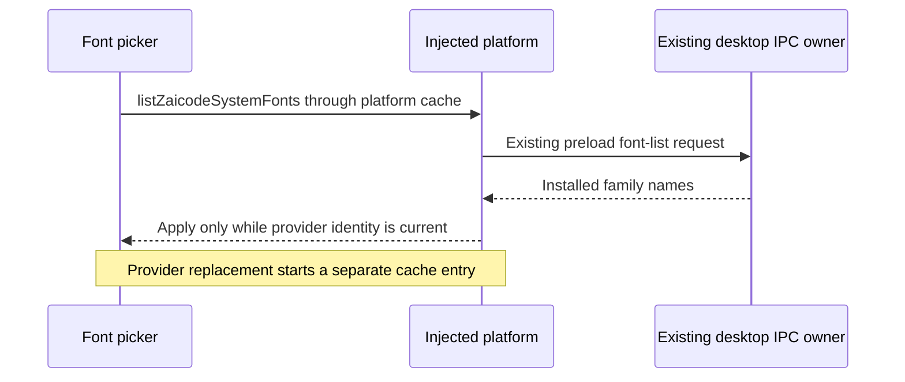

# ZAICODE system font platform boundary

T-278 removes the direct desktop bridge from the shared font picker and the
module-wide promise that lets one platform supply another platform's choices.

`IPlatformService.listZaicodeSystemFonts` is the existing optional capability.
The desktop adapter maps it to the existing preload/IPC/native font owner.
The shared UI obtains that capability through `PlatformProvider` and
`usePlatform`; a web platform without the capability keeps curated choices
and the custom-name field.

Renderer requests/results are cached per platform object in a WeakMap. Pickers
on the same platform share one request. Empty or rejected requests are not
cached indefinitely; a later mount can retry. A replaced provider cannot read
another platform's cached list or publish the previous provider's late result.
The first render after provider replacement offers no old installed choices.

Font setting values do not change: an installed family remains the `custom`
choice plus its existing name. No storage migration, new IPC channel or native
enumeration algorithm is introduced. Existing Windows family parsing and font
selection/persistence remain applicable.

Acceptance must prove injected native fonts, shared requests on one provider,
separate lists after provider replacement, rejection/empty retry, late-result
isolation, missing-capability curated choices, and desktop capability mapping.
Use the unchanged test and mounted-provider oracle against the frozen original
owners and repaired owners. Run typecheck, lint, architecture and the repository
test suite. Actual native evidence remains distinct from the browser fixture.
