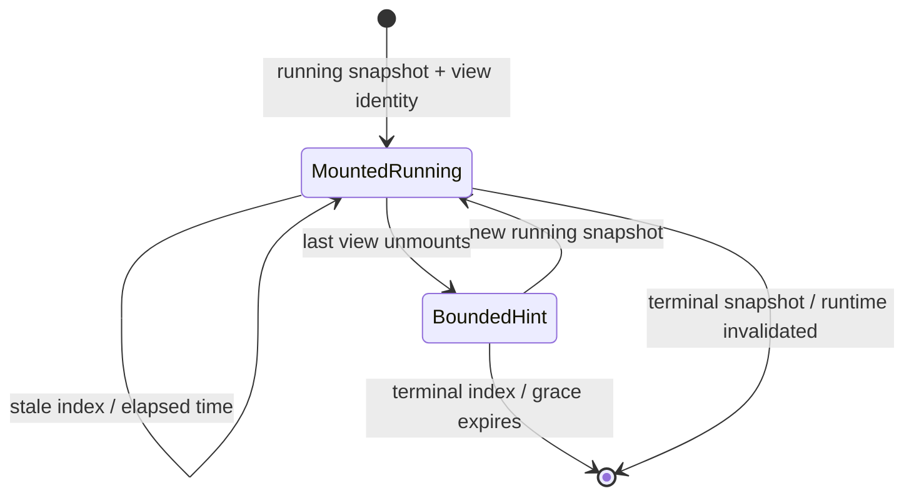

# Live project indicator (T-282 / SRC-184)

A mounted chat's running report currently expires after60 seconds when its
sessions-index row lags. A real multi-minute turn consequently looks idle in
the project sidebar. `zaicodeLiveRuns` remains a renderer projection of the
conversation snapshot, never a second execution owner.

Each mounted publisher has a React view identity stored with that existing
projection. While a view reports a running snapshot, reconciliation retains
its report regardless of a stale low-frequency index. A terminal snapshot
clears the report immediately. Unmount releases that view without claiming
execution stopped; the last observation then has the existing60-second index
grace. Multiple views release independently. Runtime death or replacement
clears all reports through the existing lifecycle path. A new snapshot revision
can publish again; a timer cannot invent new running evidence. `since` remains
the start anchor, separate from the last observation used for expiry.

The existing project and session working glyphs consume the projection. Their
appearance preferences and unrelated projects retain existing owners. Regression
acceptance must show a mounted run stays visible past several grace windows,
stale inactive index cannot erase it, terminal/runtime clear still wins, last
view release restores bounded expiry, and one view cannot erase another.
Browser acceptance mounts the real hook and shared working glyph, including
unmount/reopen and lifecycle invalidation. No agent or model request is needed.
