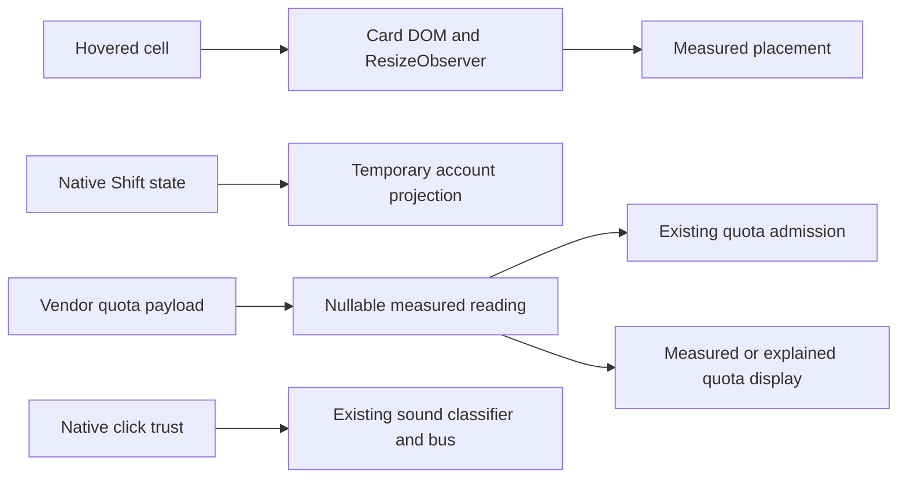
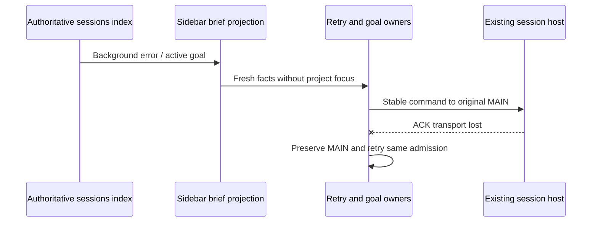

# Automation and screenshot acceptance (SRC-198 / SRC-199)

The request requires verification of actual behavior before further hardening.
The current working tree includes earlier implementations; passing their unit
tests does not alone establish background execution or screenshot acceptance.
Each requested behavior is checked against its existing owner and command path.

## Confirmed remaining presentation defects

- `ZaicodeAnchoredCard` owns its measured DOM geometry. Placement uses the
  rendered content height, not a zero-height placeholder. The initial card stays
  invisible until layout measurement; resize/content changes recompute placement.
  A TODO hover remains adjacent to its actual cell and within the viewport.
- The limits popup temporarily shows every discovered account while Shift is
  held, including engine-hidden accounts, in the configured display order.
  Releasing Shift or losing window focus restores ordinary filtering. Holding
  Shift does not persist preferences or initiate quota/generation requests;
  the existing Shift+Click refresh command keeps its meaning.
- Antigravity buckets with a reset time and no valid remaining fraction retain
  an unknown (`null`) reading. Disabled buckets still block admission. A quota
  row inferred from a clock reset or blocked by another quota does not print a
  measured percentage; its existing refill/block explanation remains visible.
  Reported numeric readings, including genuine zero, remain visible.
- The Link sound is an interface cue for a followed user link. Programmatic
  `anchor.click()` downloads must not produce it. The click classifier consumes
  the event's native trust fact; other intentional control and preview cues keep
  their existing event path. This explains a concrete possible phantom source,
  not every occurrence on the operator's machine.

## Acceptance and existing changes

Verify composer width for draft and established sessions at the same pane width,
with and without the adjacent Board; verify one project-owned Board and repeat
toggle; check TODO card position and all visible control rectangles at 640px and
desktop width. Exercise background session start/stop, retry/goal continuation,
and scheduler recovery without activating the project. Probe 9router restart,
reconnect and transient provider failure through its existing host supervisor.
Codex worker commands must use full access and advertised unattended flags;
runtime ownership, cancellation and explicit user STOP remain authoritative.

SAIHUNT supplies independent reproduced findings through its own OUTBOX. Fixes
must retain one owner, acknowledged dispatch and durable replay boundaries.
Desktop continuous and mobile replayable projections consume the same session
facts; UI caches never invent execution. No acceptance requires paid inference
or restarting the operator's running application.

The actual populated-session check reproduced a 16px difference at identical
pane width: the centered draft inherited 16px padding on both sides, while the
established composer used 8px. ZAICODE uses 8px horizontal padding in both
branches. Upstream layout and the existing reservation for an actual adjacent
status panel keep their respective owners; a Board narrows the pane for both.

## Reproduced automation failures (SAIHUNT HUNT-005)

HUNT's retained Save All gap is part of this hardening: notification sound
selection and its custom filename, SAIPEN section expansion, and TODO window
layout are durable profile preferences. The existing settings snapshot owns
capture and bundled defaults; their current readers must consume that owner.
Existing local values continue to win. Notification custom audio travels through
the snapshot's existing cue-audio map as `notification.custom`, and the existing
sound player uses it only when no locally imported file exists. A selected custom
file that cannot be captured is an explicit Save All error, never a successful
snapshot with missing audio. Session identities, run history and scheduler
markers remain excluded by the existing snapshot projection.

The desktop main process remains the scheduler process owner. Unexpected child
exit clears that generation and schedules one restart with bounded backoff;
manual wake can start the missing child immediately. Messages from a retired
generation are ignored. Dispose cancels restart and never forwards new cron or
off-peak requests. Durable occurrence claims remain owned by the existing
scheduler repositories; restart creates no separate queue.

`startZaicodeInMain` creates a fresh MAIN only from the existing authoritative
decision that no continuable MAIN exists. A send or ACK transport failure keeps
the original MAIN binding and reports a retryable failure. It cannot prove that
the MAIN disappeared, and must not start a second session after the first host
may have accepted the command.

The sidebar's automation briefs and waiting projection consume committed rows
merged with current sessions-index facts. Live terminal/error/goal rows are
included for this purpose even when they are outside visible membership.
Workspace identity isolation and newer-evidence/tie-to-live semantics are shared
with the existing liveness union. Archived rows are excluded from live-only
automation admission. Running glyphs retain their existing narrower live-only
filter; a failed session may need a retry without being described as running.

