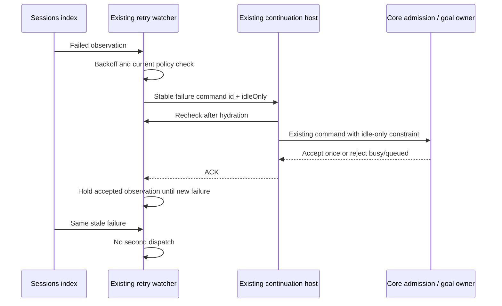

# Automatic retry dispatch admission (T-283 / SRC-185)

The background retry watcher currently releases its in-flight fence as soon as
the host accepts a continue command. A stale failed sessions-index brief can
then schedule the same `cc` again while the accepted command is executing or
waiting in the queue. Accepted submission is not a new failure observation.

The watcher retains an observation latch for the accepted `(sessionId,
updatedAt)` failure. It clears that latch only after a non-failed observation
or a different failure timestamp. A stable command id for that failure keeps
an uncertain ACK from creating a second accepted input. This latch is scheduling
evidence, not an accepted queue; the host remains the command/queue owner.
Current live running reports also exclude a session from selection and are
rechecked after asynchronous hydration through the existing `canDispatch` seam.
Explicit manual stop, closed error and current safety policy remain authoritative.

`ZaicodeContinueOptions.idleOnly` is an additive command boundary: automatic
background retry and crash resume set it, ordinary operator Continue keeps its
existing behavior. `sendText` and `sendGoalCommand` carry the optional field in
the existing shared payload schemas. The CLI checks its current routing, actual
Core foreground work and existing queue before any automatic input can enter.
Text sends also pass Core's existing `requireIdle` to atomic admission, covering
a turn that starts during asynchronous model readiness. Goal updates recheck
idle immediately before mutating the existing target. Busy or queued sessions
reject the automatic command instead of appending it. No new queue, provider
state, protocol transport or retry preference is added.

The existing pure goal text parser and queue formatter move into
`commands/goal-command-text.ts` to keep the handler within its existing line
limit. `goal-compact.ts` re-exports the parser, preserving its public import path
and text semantics. The architectural limit is not raised.

Desktop and remote continuation use this same command contract. A renderer
restart loses only the observation latch; the stable command id and host idle
admission remain effective. Old already-queued user inputs are not rewritten.
Acceptance includes unchanged old/new controls for busy text/goal, existing
queue, a model-readiness race through real Core admission, manual queue behavior,
and the real background hook receiving repeated unchanged failed briefs after
ACK. A new failure must schedule again. No model inference is required.
