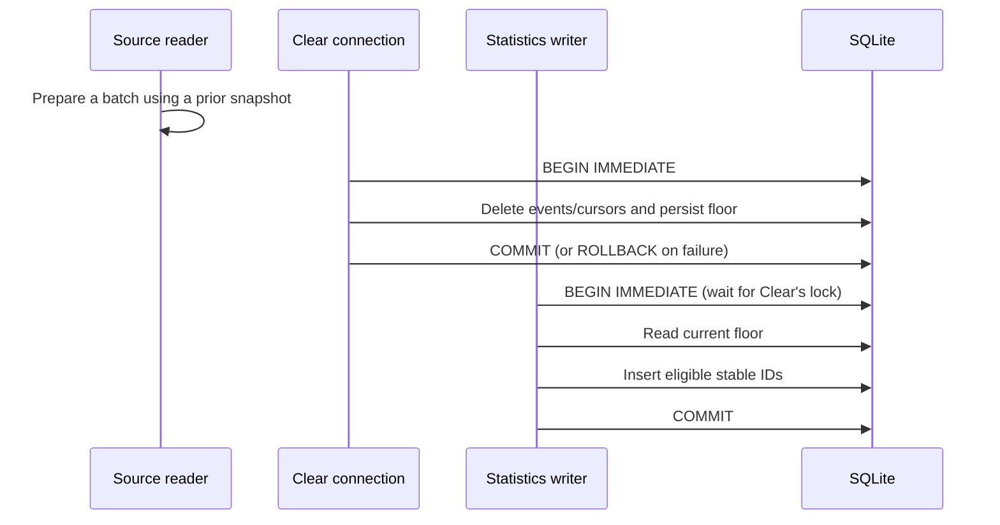

# ZAICODE statistics integrity

Authority: existing T-255 and T-256; runtime reliability handoff SRC-181.
This specification changes local statistics storage and ingestion, not subscription
authentication, MAIN identity, account ownership, or public release authority.

## Clear barrier (T-255)

`ZaicodeStatsRepo` owns accepted statistics history and the durable Clear floor.
Other services may filter prepared batches, but only the SQLite writer can enforce
the authoritative floor. The floor is inclusive: an event whose `at` equals the
floor remains eligible; one whose `at` is smaller is excluded. Model/turn event
`at` retains its existing start-time meaning; queue/worker `at` remains end time.

Clear acquires `BEGIN IMMEDIATE`, deletes statistics events and cursors, writes
the new floor, and commits once. Failure at any step rolls back the whole Clear,
including events and cursor state. It touches no job, session or account tables.
Event insertion acquires the same SQLite writer lock before reading the floor,
then filters every source's events within that transaction. Stable event IDs
continue to use `INSERT OR IGNORE`, so replay cannot double count.

Acceptance uses real SQLite files and connections: reject the floor write with
a database trigger and prove rollback; submit a stale prepared batch after a
second connection clears; race an insertion with another writer's locked Clear
transaction; clear between service preparation and insertion; prove inclusive
boundary, new events, durable restart, replay, and preservation of queue rows.
The same tests must fail against the pre-fix owner and pass after its repair.

## Lossless source progress (T-256)

Each independent source stream needs stable bounded progression across equal
completion timestamps. Source completion order and event `at` are distinct.
Queue, model usage and turn usage must not share an optimistic watermark that
can advance beyond unprocessed rows. Persist incomplete scan progress, commit
accepted rows before progress, retain replay overlap, and reset statistics-only
progress atomically with Clear. Never use OFFSET over a changing source.

An existing database must retain events, jobs and the frozen migration ledger.
Any necessary additive migration requires old-database upgrade/restart tests.
Source readers remain read-only; their boundedness must be demonstrated with
query plans and large tied-timestamp fixtures, including the turn stream.

The statistics repository owns three independent scans: `queue`, `agent-model`
and `agent-turn`. Each pass admits at most 5,000 rows from each stream. A scan
captures an upper completion time and persists its lower replay boundary and
last composite key. Queue keys are `(finished_at, job_id)`, model keys are
`(COALESCE(completed_at, started_at), id)`, and turn keys are
`(COALESCE(completed_at, started_at), session_id, turn_id)`. A full page keeps
the scan open; only a shorter page completes its watermark. The next completed
scan replays five minutes inclusively. Late records behind an open scan's key
are therefore picked up on the next overlap scan when within that interval.
Usage pages first seek the remaining stable keys at the current timestamp,
then seek later timestamps with the remaining page allowance. SQLite's single
row-value predicate on a completion expression seeks only its time prefix;
splitting the two ranges avoids rescanning a saturated tie's preceding IDs.

An additive task migration creates a statistics-only progress table and a
terminal queue key index. Integer cursor storage cannot safely encode arbitrary
string IDs. A separate additive migration in the existing agent storage owner
adds completion/key indexes; the statistics reader never creates source indexes
or otherwise writes to that database. Historical migration SQL remains frozen.
The additive agent migration registrations may live in a separate manifest to
keep the existing ledger module within its enforced line limit. Preserve each
historical version, identifier, SQL byte sequence and registration order exactly.
For a legacy source without a usable query plan, a read transaction bounds a
probe to 5,001 rows: a small source can still be read, while a larger source is
reported unavailable until its normal owner upgrades it. No unbounded sort is
admitted for a large legacy source.

Events, scan position and completed watermark commit under one writer lock.
The snapshot includes a per-stream revision and a durable Clear generation;
the commit rejects a stale snapshot after another writer or Clear wins. Clear
atomically deletes progress and increments its generation even if two Clear
operations have the same timestamp. This prevents an old scan from restoring
either event history or an optimistic cursor. New agent stream cursors start
at zero on upgrade to backfill records skipped by the old shared watermark;
stable event IDs preserve already accepted history during that bounded backfill.

Required implementation evidence includes 5,001/10,000/100,000 tied timestamps,
mid-scan restart, late rows within overlap, concurrent readers/writers, replay
after failed insertion, Clear during scan, and exact persisted totals. A source
without a supported bounded scan is unavailable/partial, never silently complete.

## Delivery

Run focused SQLite regressions, typecheck, lint, architecture and the repository
pre-push suite. Keep staged native artifacts away from a running installation.
Packaged acceptance and clean Windows VM acceptance are separate evidence;
source tests cannot discharge either. No public push, tag or Release is granted.
