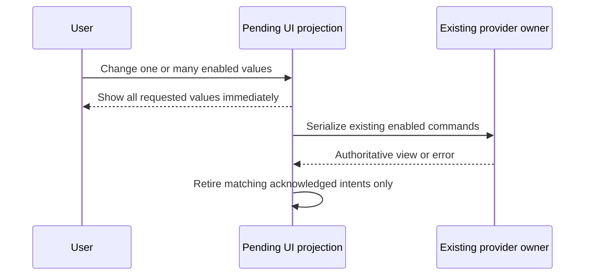

# Subscription workspace (T-279 / SRC-190)

The operator starts work with full access. An unfinished, authorized goal must
resume after reopening a project; a startup compatibility menu, ambiguous
account selection or slow settings write must not impersonate completion.

## Owners and behavior

- Goal supervision remains in `zaicodeGoalSupervisor`; the existing continuation
  owner restores active objectives from authoritative session briefs across all
  projects. It sends once per observed turn through the existing idle admission
  path. Fresh submissions do not create a second automatic send. STOP, waiting,
  terminal goals, disabled projects and real quota/budget blockers remain effective.
- Desktop discovers CLI capabilities from the installed CLI's read-only help.
  Codex workers use `--no-daemon` when supported, avoiding the shared-server
  feature conflict. Supported permission and hook-trust bypass flags apply to
  YOLO launches. Older CLIs receive only supported options.
- The router credential owner uses a placeholder bearer for HTTP(S) loopback
  routers, sets only `requireApiKey=false`, and creates no client keys there.
  Remote endpoints retain authentication. Concurrent acquisitions are scoped
  to their endpoint or caller. The explicitly requested cleanup removes only
  exact `ZAICODE` entries after a private local backup; other keys remain intact.
- Model membership and persisted enabled state remain owned by the existing
  provider service. The UI projects pending click intents immediately, including
  all rows of a bulk change in one render. Writes remain serialized. Old replies
  cannot replace newer intents; errors remove only their own intent and show the
  authoritative value. Changing provider invalidates old pending UI work.
- Subscription selection identifies each account before selecting its models.
  Matching uses provider and account identity; ambiguous matches stay explicit.
  Composer labels identify colliding models' account. Default selections remain
  visibly pressed. Right-click on a model sets its default.
- Scheduler Watch resolves the subscription behind a selected router runner;
  it includes measured account rows and explains missing quota-watch capability.
- Subscription order is user controlled and durable. Antigravity displays 5h
  before weekly. The meter, sidebar and hover list share the display filters;
  filtering does not change dispatch eligibility.
- Usage provides Global, Project and Session scopes, an adjustable persisted
  inspector width, compact view on left click and full inspector on right click.
  Global reads 9router's existing counters. Project/Session read locally recorded
  model requests for configured router provider IDs through the statistics owner,
  applying project, session and period together. They never divide global totals
  or include direct providers. Historical traffic without recorded attribution
  stays Global; missing scoped prices display unmeasured cost.
  Contract example: `zaicodeStatsService.getRouterUsage({providerIds:["sairoute"],
  project:"V:/work",sessionId:"session-1",since:0})` returns only that session's
  recorded router requests, bounded recent rows and aggregated counters/trend.
- TODO hover cards anchor near their trigger. Icons retain a non-shrinking box
  and controls wrap or clip labels without painting over adjacent controls.
  Transcript controls switch to the compact selector before fixed buttons
  consume the width reserved for history, copy, navigation and the status dock.
  At narrow widths the redundant Transcript label yields space to controls;
  every visible button retains an independent hit target.
  A limits card accepts pointer and keyboard interaction. Moving from the
  trigger into the card keeps it open, so Show all and filter controls work;
  leaving both pointer and focus closes it and resets the temporary expansion.
  Escape closes it immediately. Measured router accounts remain available under
  Scheduler Watch even when they cannot launch a CLI worker.
- Board has one visible owner (SRC-191). A chat uses its workspace side pane;
  the global inspector serves drafts only. Registering a chat owner drops stale
  inspectors, transferring a same-project draft inspector into that side pane.
  The composer cannot open a second board or show a previous project's board.
  The workspace's shared Board also toggles closed when a draft or another
  session originally opened it; session ownership must not block its toggle.
- The provider connection page embeds the connected router's own complete
  catalogue (SRC-169:R004). Reuse the established embedded browser for its API
  key, OAuth and connection-editing flows; a copied catalogue loses newly
  installed providers and vendor-specific settings. Keep existing quick controls
  under a collapsed section. The endpoint follows the router owner, browser login
  stays in its existing browser profile, and re-reading after edits updates the
  existing router and subscription stores. No host credential enters the page.
- Sidebar AUTO continues eligible project work independently of automatic A3
  admission (SRC-193). Its right-click settings expose `Run A3 audits after
  project work` and the cycle limit. The audit service persists this separate
  `autoAudits` policy, defaulting to the existing enabled behavior. Disabling it
  prevents automatic campaigns, planned resumes and remediation; ordinary
  continuation and manually started audits keep working. The existing global
  wave-generation switch retains its separate meaning. Recheck current policy
  after asynchronous sweep reads before admitting another project.
- The provider catalogue follows the router host's effective endpoint, including
  fallback ownership; the preferred endpoint alone may be unavailable.

## Acceptance

Freeze pre-edit subjects and reproduce local key creation, missed restored-goal
continuation, missing supported worker flags and delayed model switches.
Verify fixed behavior with delayed and rejected writes, rapid reverse clicks,
provider replacement, restored hidden projects, STOP during pending dispatch,
duplicate brief publication, local/remote routers and concurrent endpoints.
Use mounted production components for hover, model selection, default state,
order/filter agreement, scheduler Watch, usage scopes and width, at 640px and
desktop widths. Run focused regressions, typecheck, lint, architecture and the
repository suite. Native package/release acceptance remains the final batch
after fixable source work, as instructed in SRC-186.
